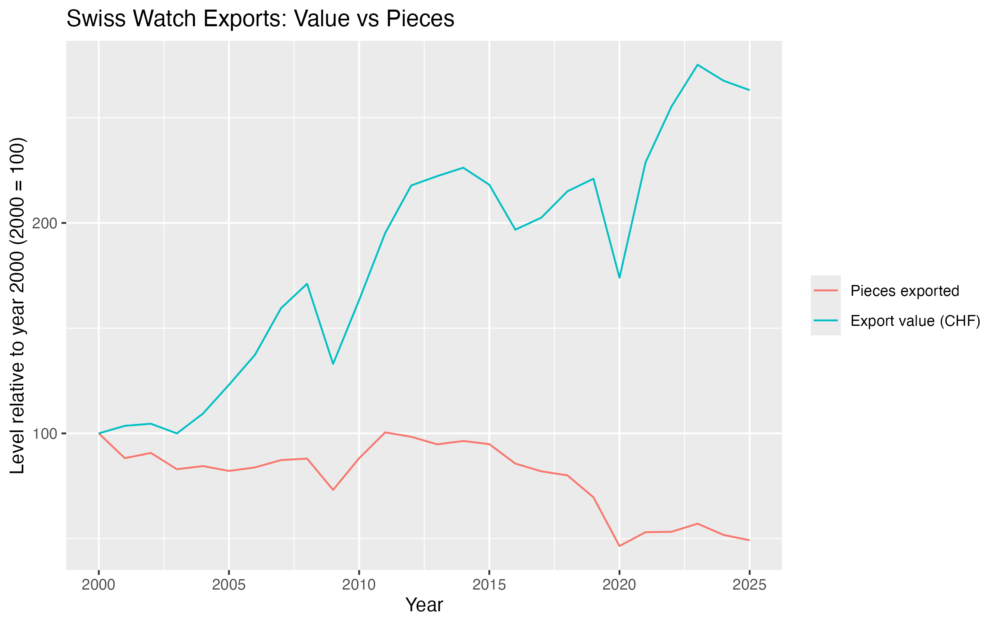

## Overview

```{r}
library(here)
library(tinytable)
```

{width="442"}

## Introduction

## Background

## 

fixed affects aborbs anything thats constant within the group wether you measured it or not so for a example a country level fixed affects would control (language, distance from swiss, culture, colonial ties, how much it has always liked watches). Fixed effects would absorb a population average population but not its population growth over time .\
\
clustering by country lets us adjust SE's and by extension p-values to account to for the unmeasured affects over time that countries experience

$$
\text{SE}(\hat\beta) \approx \frac{\text{noise left in the outcome}}{\text{independent variation in } x}
$$

once stock markets are controlled for, a higher top-1% share is associated with more imports in every tier, but the estimate is only clearly different from zero for steel quartz. The top tier the hypothesis was about, precious mechanical, shows no reliable link. That goes against the “wealth pulls the top tier” story,

```{r}

readRDS(here("output/Regressions_output", "wealth_monthly.rds"))
```

```{r}

readRDS(here("output/Regressions_output", "wealth_annual.rds"))
```

```{r}

readRDS(here("output/Regressions_output", "wealth_robustness.rds"))
```
